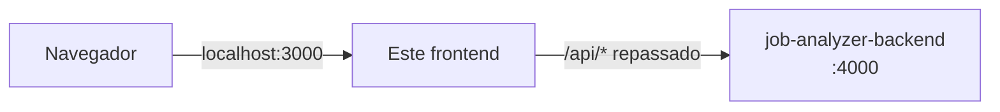

# Job Analyzer · Frontend (interface)

Interface do **Job Analyzer**, uma central de vagas que busca oportunidades brasileiras, mostra uma **nota grátis** de compatibilidade com o seu perfil e, **quando você pede**, faz uma análise completa com IA.

Este repositório **só desenha a tela**. Dados, regras e IA ficam no repositório **job-analyzer-backend**. Toda chamada vai para `/api/*`, e o Next repassa para a API.

---

## Tecnologias

| Tecnologia | Para quê |
|---|---|
| **Next.js 15** (App Router) | Páginas, rotas e repasse de `/api` para o backend |
| **React 19** | Interface |
| **TypeScript** | Tipagem |
| **Tailwind CSS 4** | Estilos, com tema por variáveis CSS (preto e dourado) |
| **lucide-react** | Ícones |
| **Fonte Inter** | Tipografia (via `next/font`) |

---

## Como conversa com o backend



O navegador fala só com o frontend. O `next.config.ts` repassa `/api/*` para o endereço em `API_URL` (padrão `http://127.0.0.1:4000`). Assim o cookie de login fica no mesmo domínio e não é preciso configurar CORS.

---

## Telas e funcionalidades

| Tela | O que tem |
|---|---|
| **Início** (`painel/`) | Primeiros passos, números da busca, melhores vagas, automação e uso da IA |
| **Vagas** (`vagas/`) | **Painel de controle** com cartões clicáveis por situação (Todas, Melhores, Novas, Com IA, Salvas, Candidatei, Descartadas), busca, **filtro por empresa** e **paginação** (20 por página). Os filtros ficam na URL |
| **Detalhe da vaga** (`vagas/[id]/`) | **Prévia grátis** com os matches (habilidades, cargo, senioridade, o que não aceito) e o botão **"Analisar com IA"**, sempre com **confirmação** antes de gastar. Vagas pouco compatíveis pedem uma confirmação mais forte |
| **Meu perfil** (`perfil/`) | Habilidades, cargos, senioridade, **níveis de vaga que quero ver**, o que não aceito e currículo. Barra "Salvar alterações" quando há mudanças |
| **Configurações** (`configuracoes/`) | Fontes (palavras-chave, empresas Greenhouse/Lever), automação, nota mínima e uso da IA |
| **Como funciona** (`como-funciona/`) | Explica o critério da nota e da análise, com os valores atuais |

Fluxo pensado para o usuário decidir: **busca → nota grátis → abre a vaga → vê os matches → se quiser, "Analisar com IA" → confirma**. Não existe análise em lote.

---

## Estrutura

```
src/
├── app/
│   ├── page.tsx              página inicial (pública)
│   ├── login/ · cadastro/
│   ├── globals.css           tema (cores em variáveis no topo)
│   └── (app)/                área logada (exige login)
│       ├── layout.tsx        AuthProvider + AppShell
│       ├── painel/           Início
│       ├── vagas/            lista e vagas/[id] (detalhe)
│       ├── perfil/
│       ├── configuracoes/
│       └── como-funciona/
├── components/
│   ├── app-shell.tsx         menu lateral, topo, notificações
│   ├── auth-provider.tsx     checa o login e redireciona
│   ├── job-card.tsx          cartão da vaga (nota da IA ou prévia)
│   ├── preview-panel.tsx     painel da prévia grátis com os matches
│   ├── pagination.tsx        paginação da lista
│   ├── add-job-dialog.tsx · save-bar.tsx · notifications-menu.tsx
│   ├── use-job-actions.ts    "Buscar vagas" e o aviso com o resultado
│   ├── use-profile-form.ts   estado do formulário de perfil
│   └── ui/                   botão, card, campos, etiquetas, anel de nota, modal, avisos
└── lib/
    ├── api.ts                cliente da API e hook useApi (401 → login)
    ├── types.ts              tipos das respostas da API
    └── format.ts             textos, datas, cores das notas
```

**Detalhe técnico:** o modal e a barra de salvar são renderizados com `createPortal` direto no `<body>`. Dentro das páginas (que têm animação com `transform`), um `position: fixed` ficaria preso à página e sairia da tela.

---

## Rodando

O backend precisa estar rodando (veja o repositório **job-analyzer-backend**).

```bash
npm install
npm run dev     # http://localhost:3000
```

| Script | O que faz |
|---|---|
| `npm run dev` | Desenvolvimento, com recarga automática |
| `npm run build` | Gera o build de produção |
| `npm start` | Roda o build de produção |
| `npm run prod` | Gera o build e já roda (modo rápido, para **usar** o sistema) |
| `npm run lint` · `npm run typecheck` | Checagens |
| `npm run test:e2e` | Testes de ponta a ponta (Playwright, no Edge do Windows): cadastro, login, logout, isolamento entre duas pessoas e o quadro de candidaturas. Sobem backend e frontend próprios (portas 4120/3120) com banco temporário e IA desligada |

Se a API não estiver em `http://127.0.0.1:4000`, crie um `.env.local` a partir do `.env.example` e ajuste o `API_URL`.

### Desempenho: desenvolvimento x produção

O `npm run dev` compila cada tela na primeira vez que você a abre, então trocar de tela leva de 1 a 2 s. Para **usar** o sistema, rode `npm run prod` ou o compound **"Rodar tudo · modo rápido (produção)"** do workspace. Nesse modo as telas abrem em cerca de 20 ms.

| Medição | `npm run dev` | `npm run prod` |
|---|---|---|
| Tela, na primeira visita | 0,7 – 1,9 s | ~23 ms |
| Tela, nas visitas seguintes | 170 – 400 ms | ~23 ms |
| API (`/api/...`) | 10 – 20 ms | 10 – 20 ms |

- O `API_URL` entra no build. Se você mudar o `.env.local`, rode o build de novo.
- O `useApi` (`src/lib/api.ts`) guarda as respostas em cache. Ao voltar para uma tela, os dados aparecem na hora e são atualizados em segundo plano. O cache é limpo no login e no logout, então um usuário nunca vê dados de outro.
- `NEXT_DIST_DIR` muda a pasta do build. Use para gerar um build de teste sem mexer no `.next` do servidor de desenvolvimento.

---

## Personalizando

| Quero... | Onde |
|---|---|
| Mudar as cores | Variáveis no topo de `src/app/globals.css` (`--primary` é o dourado) |
| Nova página | `src/app/(app)/<nome>/page.tsx` + item em `NAV` no `components/app-shell.tsx` |
| Novo componente visual | `src/components/ui/` |
| Chamar uma rota nova da API | `api()` ou `useApi()` de `src/lib/api.ts` + tipo em `lib/types.ts` |
| Mudar quantas vagas por página | `pageSize` na chamada de `/jobs` em `vagas/page.tsx` (o backend aceita de 5 a 100) |
