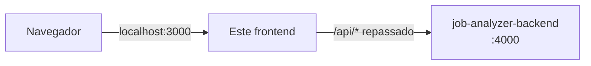

# Job Analyzer · Frontend (interface)

Interface do **Job Analyzer**, uma central de vagas que busca oportunidades, analisa cada uma com IA de acordo com o perfil do usuário e avisa só das que valem a pena.

Este repositório **só desenha a tela**. Dados, regras e IA ficam no repositório **job-analyzer-backend**. Toda chamada vai para `/api/*`, e o Next repassa para a API.

---

## Tecnologias

| Tecnologia | Para quê |
|---|---|
| **Next.js 15** (App Router) | Páginas, rotas e repasse de `/api` para o backend |
| **React 19** | Interface |
| **TypeScript** | Tipagem |
| **Tailwind CSS 4** | Estilos, com tema por variáveis CSS (preto e dourado) |
| **lucide-react** | Ícones |
| **Fonte Inter** | Tipografia (via `next/font`) |

---

## Como conversa com o backend



O navegador fala só com o frontend. O `next.config.ts` repassa `/api/*` para o endereço em `API_URL` (padrão `http://127.0.0.1:4000`). Assim o cookie de login fica no mesmo domínio e não é preciso configurar CORS.

---

## Estrutura

```
src/
├── app/
│   ├── page.tsx              página inicial (pública)
│   ├── login/ · cadastro/
│   ├── globals.css           tema (cores em variáveis no topo)
│   └── (app)/                área logada (exige login)
│       ├── layout.tsx        AuthProvider + AppShell
│       ├── painel/           Início
│       ├── vagas/            lista e vagas/[id] (detalhe)
│       ├── perfil/
│       ├── configuracoes/
│       └── como-funciona/    explica o critério da análise
├── components/
│   ├── app-shell.tsx         menu lateral, topo, notificações
│   ├── auth-provider.tsx     checa o login e redireciona
│   ├── job-card.tsx · add-job-dialog.tsx · save-bar.tsx ...
│   └── ui/                   botão, card, campos, etiquetas, anel de nota, modal, avisos
└── lib/
    ├── api.ts                cliente da API e hook useApi (401 → login)
    ├── types.ts              tipos das respostas da API
    └── format.ts             textos, datas, cores das notas
```

---

## Rodando

O backend precisa estar rodando (veja o repositório **job-analyzer-backend**).

```bash
npm install
npm run dev     # http://localhost:3000
```

| Script | O que faz |
|---|---|
| `npm run dev` | Desenvolvimento, com recarga automática |
| `npm run build` | Gera o build de produção |
| `npm start` | Roda o build de produção |
| `npm run lint` · `npm run typecheck` | Checagens |

Se a API não estiver em `http://127.0.0.1:4000`, crie um `.env.local` a partir do `.env.example` e ajuste o `API_URL`.

---

## Personalizando

| Quero... | Onde |
|---|---|
| Mudar as cores | Variáveis no topo de `src/app/globals.css` (`--primary` é o dourado) |
| Nova página | `src/app/(app)/<nome>/page.tsx` + item em `NAV` no `components/app-shell.tsx` |
| Novo componente visual | `src/components/ui/` |
| Chamar uma rota nova da API | `api()` ou `useApi()` de `src/lib/api.ts` + tipo em `lib/types.ts` |
